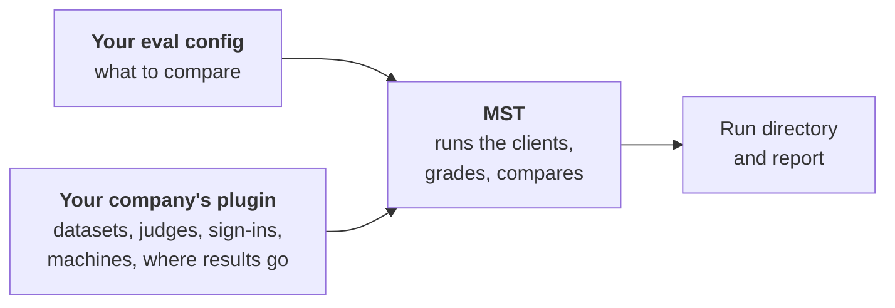
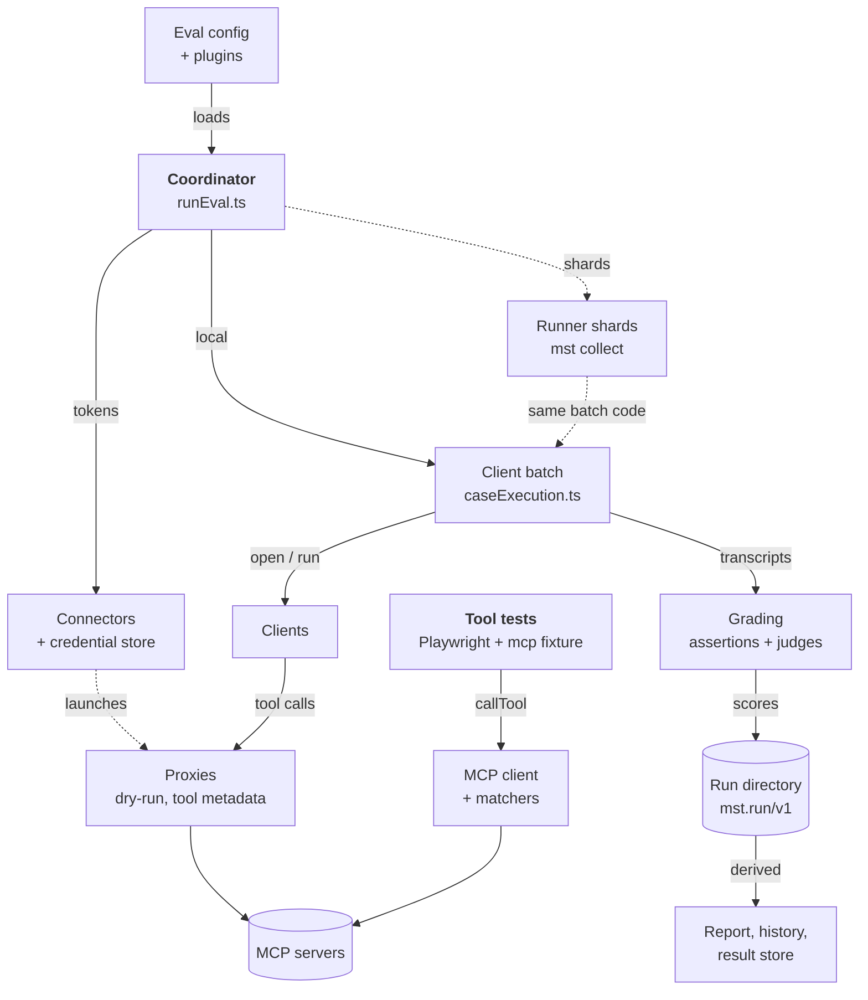
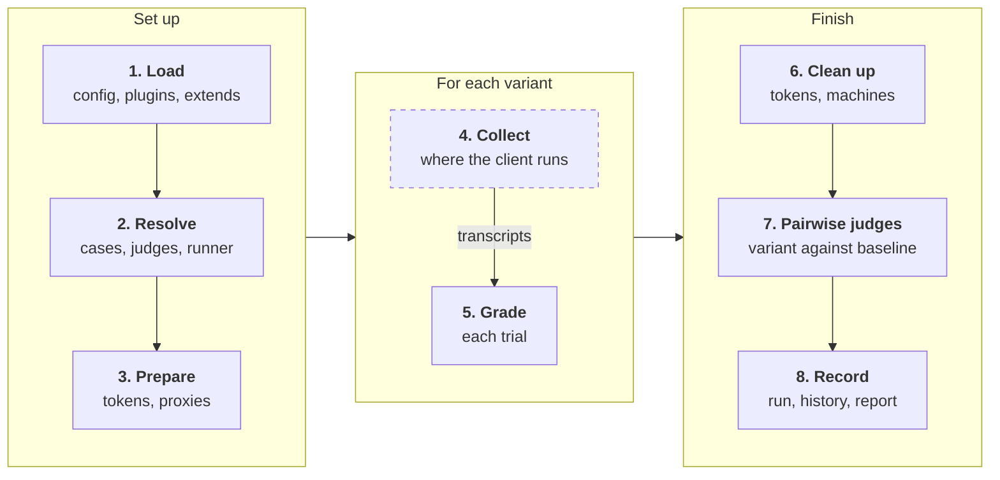
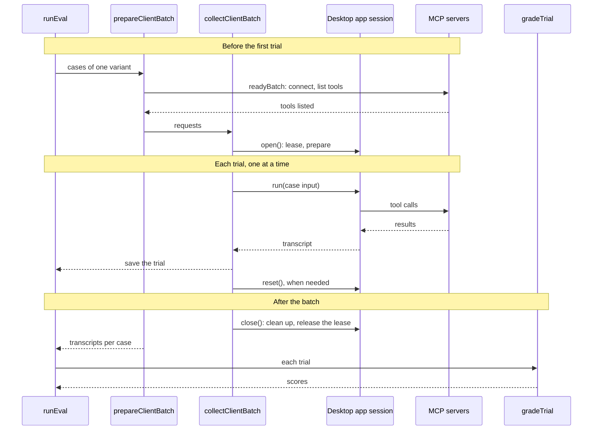
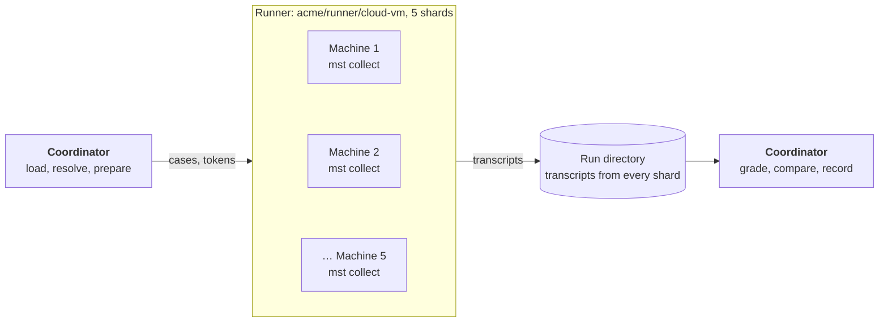
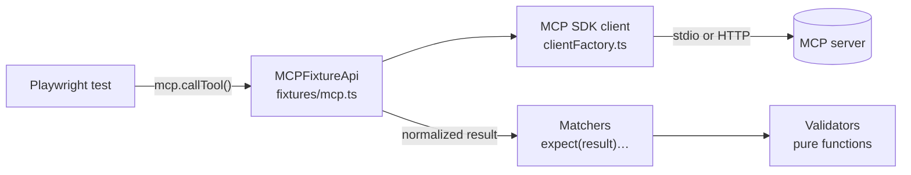

# How MST works

MST is two tools on one core. **Tool tests** are Playwright tests: they call an MCP server's tools and check the replies. **Evals** run an AI client against MCP servers, write every attempt to a run directory, grade it, and compare setups. Both use the same MCP client, the same validators and the same report.

This page explains how the parts fit together, what happens during a run, and why it works that way. It is for contributors, plugin authors, and anyone who wants to know what MST does with their config. The terms (case, trial, variant, transcript, grader, runner, connector) are defined in [`CONTEXT.md`](../CONTEXT.md). The exact contracts are in the [evaluation framework reference](./evaluation-framework.md), and the decisions behind them are in the [ADRs](./adr/).

## The problem evals solve

Say you run an MCP server and have rewritten its tool descriptions. You want to know whether Claude Desktop picks the right tools and gives better answers with the new descriptions. Asking it one question tells you little:

- **The same question gets different answers.** One good answer could be luck, so each case runs several **trials**.
- **One question isn't representative.** You need dozens of realistic cases, each with a known good answer.
- **"Better" needs a consistent grader.** An LLM judge can grade hundreds of answers, but it has to grade every one the same way.
- **The comparison has to be fair.** Every **variant** gets the same cases, model, client and servers; only what you are testing changes.
- **Real clients are desktop apps.** MST drives them as a person would, on a Mac or in Linux containers or VMs. That is slow, so long runs are split across machines.
- **Your data and credentials are yours.** Datasets, grading rules and sign-ins are company-specific, so they live in a plugin, not in MST.

## Three parts, three owners

An eval brings together three things, and each one has a different owner.

| Part                      | Owner                              | Changes when                              | Knows about your company?         |
| ------------------------- | ---------------------------------- | ----------------------------------------- | --------------------------------- |
| **MST**                   | Open source                        | MST releases                              | No                                |
| **Your company's plugin** | Your company (a platform team)     | Datasets, judges or infrastructure change | Yes                               |
| **Eval configs**          | You or your team, in your own repo | You want to compare something new         | Only the plugin's extension names |

MST stays generic: no tenant URLs, internal datasets or cloud accounts. Each part changes at its own pace, so a new comparison never needs a plugin release, and a new dataset never needs an MST release. MST has built-ins for most of what a plugin adds, so you can run evals without one. Every extension is named `<namespace>/<kind>/<name>`, such as `acme/judge/correctness`, and MST checks the kind wherever a name is used ([ADR 0003](./adr/0003-extension-names-say-their-kind.md)).

## Where a change goes

Core runs an eval the same way for every client. **A client is one product**: Claude Desktop, ChatGPT, Codex and Claude Code each keep their code in their own directory and client file under `src/evals/`. None of them is the reference product: defaults, the run format and the report describe clients in general.

A change goes in the first home that fits ([ADR 0016](./adr/0016-mst-holds-only-what-every-mst-user-needs.md)):

1. **Does it use MST only through the `mst` command or the public exports?** It goes in its own repo.
2. **Does one organization need it?** It goes in that organization's plugin.
3. **Does one client product need it?** It goes in that product's code. Core reaches it through the client definition.
4. **Does every user of MST need it?** It goes in core. A new contract, mode or protocol has an accepted ADR before its code merges.

`tests/repoShape.test.ts` checks the parts of this a test can check: no other language, no second package, no new top-level directory, and no new import of product code from core.

## The parts

| Part               | What it does                                                                                                                                                                                                                    | Code                                                                                                                                  |
| ------------------ | ------------------------------------------------------------------------------------------------------------------------------------------------------------------------------------------------------------------------------- | ------------------------------------------------------------------------------------------------------------------------------------- |
| Coordinator        | `mst run` hands its flags to `runEval`, whose `evaluate` function owns the whole run: load, collect, grade and record. It runs wherever you typed `mst run`.                                                                    | [`runEval.ts`](../src/evals/runEval.ts), [`cli/index.ts`](../src/cli/index.ts)                                                        |
| Eval config        | One JSON file names the datasets, variants, servers, judges and metrics. `plugins` loads extensions; `extends` pulls in shared configs.                                                                                         | [`evalConfig.ts`](../src/evals/evalConfig.ts), [`evalPlugins.ts`](../src/evals/evalPlugins.ts)                                        |
| Connectors         | Describe how a server signs in and how the client reaches it. Refresh grants stay on the coordinator; clients get short-lived access tokens.                                                                                    | [`connectorServers.ts`](../src/evals/connectorServers.ts), [`auth/grants/`](../src/auth/grants/)                                      |
| Runner shards      | `local` collects in this process. `docker` or a plugin runner starts machines, and each runs the hidden `mst collect` with the same batch code.                                                                                 | [`evals/runners/`](../src/evals/runners/)                                                                                             |
| Client batch       | A variant's cases on one client. Every case runs through one function, whatever the client and wherever it runs. Readiness checks, resets and limits apply here.                                                                | [`caseExecution.ts`](../src/evals/caseExecution.ts), [`prepareClientBatch.ts`](../src/evals/prepareClientBatch.ts)                    |
| Clients            | The AI application under test: `api`, `claude-code` and `codex-cli` run as processes; `cowork`, `chatgpt` and `codex-app` drive desktop apps. Plugins can add more. See [the clients table](./evaluation-framework.md#clients). | [`builtinClients.ts`](../src/evals/builtinClients.ts)                                                                                 |
| Proxies            | Sit between a client and some of its servers. The dry-run proxy lets reads through and blocks or simulates writes; the tool-metadata proxy serves a variant's rewritten tool descriptions.                                      | [`proxy/`](../src/proxy/), [`toolSurfaceProxyServer.ts`](../src/evals/toolSurfaceProxyServer.ts)                                      |
| Grading            | Assertions, judges and the `writes` grader score each trial. Pairwise judges compare two variants' trials of a case.                                                                                                            | [`grading.ts`](../src/evals/grading.ts), [`judge/`](../src/judge/)                                                                    |
| Run directory      | Every run's files, in the versioned `mst.run/v1` format. It is the only state a run keeps.                                                                                                                                      | [`runFormat.ts`](../src/evals/runFormat.ts)                                                                                           |
| Report and history | Both are rebuilt from run files. A result store gets a copy of the whole run directory.                                                                                                                                         | [`runReport.ts`](../src/evals/runReport.ts), [`runHistory.ts`](../src/evals/runHistory.ts), [`runStore.ts`](../src/evals/runStore.ts) |
| Tool tests         | The Playwright fixture gives each test an MCP client. Matchers wrap the same validators that grade evals. No coordinator is involved.                                                                                           | [`fixtures/mcp.ts`](../src/fixtures/mcp.ts), [`mcp/`](../src/mcp/), [`assertions/`](../src/assertions/)                               |

## One `mst run`, start to finish

Every step runs on the **coordinator**, the machine where you typed `mst run`, except step 4 (dashed), which runs wherever the client runs: this machine, or a runner's machines. With `--grade-runner`, step 5 runs on the runner's machines too.

### 1. Load

`loadEvalConfig` reads the eval config, `loadEvalPlugins` loads its plugins, and `resolveConfigExtends` merges any shared configs. Every name must exist and be the right kind, and every variant's servers must be defined.

_Why first:_ a typo should cost a second, not an hour of desktop time.

### 2. Resolve

Names become exact content. A dataset name becomes specific cases, from the plugin's snapshot unless you ask for live data. A judge name becomes a specific rubric, model and threshold. `validateEvalConfig` checks each client against the OS of the machines that will run it, and judges are checked before any client starts. `run.json` records a content hash of each dataset and judge. `--dry-run` stops here and prints the plan.

_Why:_ a result only means something if you know exactly what was tested and how it was graded. Two runs can be compared knowing whether their data matched.

### 3. Prepare

`startConnectorCredentials` checks that every refresh grant the run needs is in the credential store, exchanges each one for a short-lived access token, and renews it until the run ends. A missing or revoked grant stops the run with the `mst auth` command that fixes it. Connectors may launch a proxy in front of their server.

_Why:_ you sign in once, not once per run. No token goes into an eval config, transcript, log or report. See the [connector contract](./connectors.md).

### 4. Collect

For each variant, MST hands a **batch** of cases to the client. Before the batch's first trial, `readyBatch` connects to each server and lists its tools; it retries after 10 s and 30 s, and if a server still fails, every trial in the batch ends as a retryable setup failure. Then each trial gets the case's input as a user would type it. Each transcript is written as soon as its trial ends, so a stopped run keeps every finished trial.

Nothing is graded here. A trial that hits an infrastructure problem, such as the client crashing, is not a failed trial: the client never answered. Pass rates leave it out ([ADR 0010](./adr/0010-a-trial-ending-is-decided-where-it-ends.md)).

With `--runner`, the trials run on other machines. See [Runners and shards](#runners-and-shards).

### 5. Grade

`runEvalDataset` calls `gradeTrial` for each trial: the case's assertions, the eval config's judges and the case's own judges, and the `writes` grader. Locally, a variant's trials are graded right after its batch, then the next variant starts. With shards, the coordinator grades what the workers sent back, or `--grade-runner` grades on the runner's machines ([ADR 0005](./adr/0005-grading-runs-in-an-environment.md)).

_Why grading is separate from collecting:_ collecting is slow and expensive, and grading is cheap. Because graders read only stored transcripts, `mst grade <run-id>` can regrade with a new rubric or an extra judge, without running the client again. A regrade is a new run, `<run-id>.g2`, that names the original in `gradedFrom`. `--no-grade` stops after collecting. Both need `"redactStoredResponses": false`.

### 6. Clean up

MST stops renewing tokens, removes the ones it handed out, stops proxies, and resets the client. Containers and VMs are deleted unless `--runner-option keep=failed` keeps a failed one. Clean-up runs even when the run fails or you press Ctrl-C.

### 7. Pairwise judges

A pairwise judge reads two variants' trials of the same case and says which is better. It needs both sides, so it runs after every variant has been collected and graded.

### 8. Record

`writeRun` writes `results.json` (every case result) and `summary.json` (per-variant metrics, deltas from the baseline, and the comparison with the previous run). Then MST updates the eval's `history.json`, builds the report, writes `latest.json` (for complete, full runs only), and uploads the run directory to the result store if there is one.

The report compares each variant with the baseline **case by case**, as a paired test, and says whether each metric is better, worse or unclear. "Unclear" means the difference could be chance at this number of cases and trials. Comparing the same case across variants removes the spread between easy and hard cases, so a real difference shows up with fewer cases.

## How a batch drives a client

There are two kinds of client. **Run-only** clients (`api`, `claude-code`, `codex-cli`) run each case on its own, up to `concurrency` at a time. **Session** clients (`cowork`, `chatgpt`, `codex-app`) drive one desktop app, so they open a session once and run its trials one after another:

`collectClientBatch` owns everything a desktop client would otherwise repeat: the lease on the desktop, resets between trials, diagnosing failures, and stopping after repeated failures. A client supplies only `open`, `run`, `reset`, an optional `diagnose`, and `close`. `cowork` checks its servers after `open` prepares it, because its servers are known only then.

How a desktop client runs follows from the OS of the machine that runs the trial, never from a config option ([ADR 0011](./adr/0011-a-client-is-a-product-and-how-it-runs-is-not-configuration.md)). Each desktop client has a `macos.ts` and a `linux.ts` entry point. [ADR 0017](./adr/0017-desktop-clients-share-one-automation.md) (proposed) would give both platforms one accessibility automation.

## Runners and shards

A desktop client runs one conversation at a time per machine. Fifty cases, three variants and three trials, at a minute or more each, take hours on one machine. A runner splits the trials across machines, called **shards**:

A runner only creates machines and opens a **channel** to each: run a command with its input and output attached, and copy files in and out. Docker, SSH and Kubernetes all provide one. Over the channel, MST copies the shard's cases to the machine and starts `mst collect`, which runs the same batch code a local run uses. The worker and coordinator exchange `mst.shard/v1` JSON messages: progress, heartbeats, and access tokens, which the worker keeps only in memory-backed files. Refresh grants never leave the coordinator ([ADR 0004](./adr/0004-environments-run-shards-over-a-channel.md)).

A case's variants and trials all go to one shard, so each comparison is made on one machine, minutes apart. The eval config's `limits` cap how many trials run at once across all shards, per LLM provider and per server. If a shard fails, its trials are **missing**, not failed, and `mst run --resume <run-id>` collects only those. `--detach` moves the coordinator itself to a machine the runner creates, so yours can go offline ([ADR 0007](./adr/0007-detached-runs-move-the-coordinator.md)).

_Why `--runner` is a flag and not part of the eval config:_ where the client runs doesn't change the question you are asking. The same config works for a quick local check, a run on VMs, and a nightly CI job.

## The run directory is the contract

Every eval has a directory, and each run is a directory inside it, in the `mst.run/v1` format: `run.json` (what ran), a transcript and a score file per trial, `results.json`, `summary.json` and the report. [What a run leaves behind](./evaluation-framework.md#what-a-run-leaves-behind) has the full layout and its rules, and [`schema/run/v1/`](../schema/run/v1/) has the JSON Schemas.

Everything after collection reads these files and keeps no state of its own:

- `mst grade` regrades stored transcripts into a new run.
- `mst run --resume` collects only the trials a run is missing.
- `mst open` rebuilds the report, and `mst history` reads `history.json`, which is a cache derived from the runs ([ADR 0012](./adr/0012-an-evals-history-is-derived-from-its-runs.md), proposed).
- A result store holds a copy of whole run directories, so a CI machine with no local runs still has a previous run to compare with.

Adding an optional field keeps `mst.run/v1`; readers keep fields they don't know. Removing or renaming a field moves the format to v2. Other tools, such as a company dashboard, can read the files directly without depending on MST's code.

## Tool tests

A tool test calls one tool and checks the reply. It is deterministic, fast and free, so it suits CI regression gates.

`createMCPClientForConfig` turns an `MCPConfig` into a connected client, choosing the transport and the protocol version (see [protocol versions](./protocol-versions.md)). Protocol errors, such as an unknown tool, come back as an error result rather than an exception. `runConformanceChecks` checks the server against the MCP spec for the negotiated protocol version. A test can also run eval cases on the `api` client with `runEvalDataset`, over the test's own connection.

_Why validators and matchers are separate:_ validators are pure functions that return a `ValidationResult`, with no Playwright dependency. Eval grading calls them directly. Each matcher is a thin Playwright adapter over one validator, so `expect(result).toContainToolText()` and an eval's `containsText` assertion can't disagree.

_Why Playwright and Vitest:_ MST's own integration tests use Playwright against mock servers, so they exercise the same fixtures, config and reporter that users run. Unit tests for pure logic use Vitest, which doesn't start browser workers. `npm test` runs Vitest; `npm run test:playwright` runs Playwright.

## Where MST can be extended

A plugin is a plain object that MST reads; it never calls into MST to register ([ADR 0001](./adr/0001-eslint-style-declarative-plugins.md)). Each kind's built-ins install on first lookup, so code that needs only judges never loads desktop drivers.

| Kind               | Example name                     | Built-ins                                                                |
| ------------------ | -------------------------------- | ------------------------------------------------------------------------ |
| `dataset`          | `acme/dataset/info-seeking`      | `file`, `dir`, `gcs`                                                     |
| `client`           | `acme/client/x`                  | `api`, `claude-code`, `codex-cli`, `cowork`, `chatgpt`, `codex-app`      |
| `judge`            | `acme/judge/correctness`         | `rubric`, `task-completion`, `grounded-in-tools`, `tool-use`, `criteria` |
| `pairwise-judge`   | `acme/pairwise-judge/preference` | none                                                                     |
| `metric`           | `acme/metric/x`                  | the [built-in metrics](./evaluation-framework.md#metrics)                |
| `result-store`     | `acme/result-store/x`            | `file`, `gcs`                                                            |
| `connector`        | `acme/connector/slack`           | none                                                                     |
| `runner`           | `acme/runner/cloud-vm`           | `local`, `docker`                                                        |
| `credential-store` | `acme/credential-store/x`        | none; MST's local store is not an extension                              |

Shared configs (`extends`) use a tenth segment, `config`. [Plugins](./evaluation-framework.md#plugins) has each kind's contract.

## Rules that hold everywhere

| Rule                                                                                          | Where it is enforced                                                                           | Decision                                                                             |
| --------------------------------------------------------------------------------------------- | ---------------------------------------------------------------------------------------------- | ------------------------------------------------------------------------------------ |
| A trial's ending, trial or infrastructure, is decided where it ends; grading never changes it | [`trialEnding.ts`](../src/evals/trialEnding.ts)                                                | [ADR 0010](./adr/0010-a-trial-ending-is-decided-where-it-ends.md)                    |
| Every client's servers are checked once per batch, before its first trial                     | [`readinessCheck.ts`](../src/evals/readinessCheck.ts)                                          | [ADR 0011](./adr/0011-a-client-is-a-product-and-how-it-runs-is-not-configuration.md) |
| Grading reads only stored transcripts, so a run can be regraded without the client            | [`grading.ts`](../src/evals/grading.ts), [`runEval.ts`](../src/evals/runEval.ts)               | [ADR 0005](./adr/0005-grading-runs-in-an-environment.md)                             |
| A shard holds whole cases; refresh grants never leave the coordinator                         | [`runners/`](../src/evals/runners/), [`connectorServers.ts`](../src/evals/connectorServers.ts) | [ADR 0004](./adr/0004-environments-run-shards-over-a-channel.md)                     |
| Every write a client attempts is recorded and matched with its transcript                     | [`proxy/`](../src/proxy/), [`writeRecord.ts`](../src/evals/writeRecord.ts)                     | [ADR 0014](./adr/0014-graders-check-outcomes-and-every-write-is-accounted-for.md)    |
| Default model IDs live in one table, and a run records each one it falls back on              | [`modelDefaults.ts`](../src/llm/modelDefaults.ts)                                              | [ADR 0015](./adr/0015-default-models-come-from-config-files.md)                      |
| An extension's name says its kind, and the kind is checked where the name is used             | [`plugin.ts`](../src/plugins/plugin.ts), [`extensions.ts`](../src/plugins/extensions.ts)       | [ADR 0003](./adr/0003-extension-names-say-their-kind.md)                             |
| MST is TypeScript; Swift only for macOS APIs that Node can't reach                            | [`nativeHelper.ts`](../src/evals/nativeHelper.ts)                                              | [ADR 0006](./adr/0006-mst-is-written-in-typescript.md)                               |

## Reading the code

To learn the code base, read it in this order:

1. [`CONTEXT.md`](../CONTEXT.md) for the terms.
2. A tool test against [`tests/mocks/dualEraServer.ts`](../tests/mocks/dualEraServer.ts), following `callTool` into [`clientFactory.ts`](../src/mcp/clientFactory.ts).
3. `evaluate` in [`runEval.ts`](../src/evals/runEval.ts), beside [One `mst run`, start to finish](#one-mst-run-start-to-finish).
4. [`caseExecution.ts`](../src/evals/caseExecution.ts), [`prepareClientBatch.ts`](../src/evals/prepareClientBatch.ts) and [`desktopBatch.ts`](../src/evals/desktopBatch.ts), beside [How a batch drives a client](#how-a-batch-drives-a-client).
5. `gradeTrial` in [`grading.ts`](../src/evals/grading.ts), then one judge, such as [`questionJudge.ts`](../src/judge/questionJudge.ts).
6. [`runners/channel.ts`](../src/evals/runners/channel.ts) and [`runners/collect.ts`](../src/evals/runners/collect.ts), beside [Runners and shards](#runners-and-shards).

[`AGENTS.md`](../AGENTS.md) has the full module map and the steps for adding a client, judge, validator or matcher.
