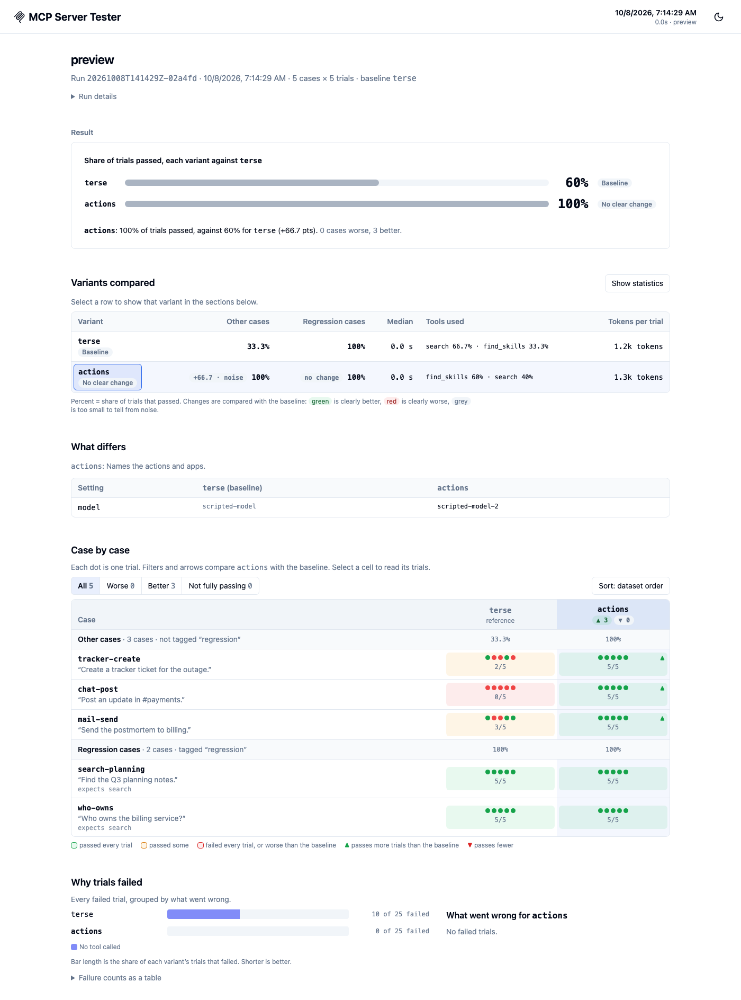
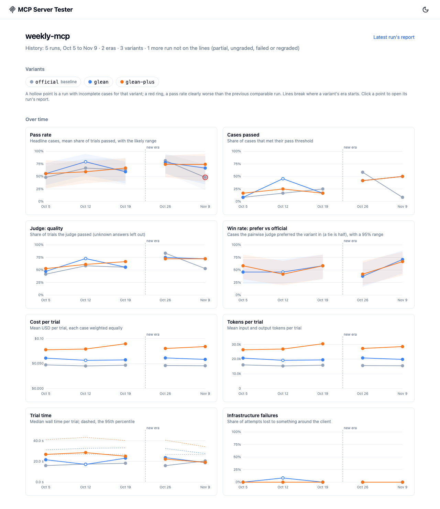

# The Run Report

Every eval run writes a report: an HTML page that answers whether each variant did better or worse than the baseline, and shows every case and trial behind that answer. `mst run` writes one with each run, and so does the MCP Playwright reporter for the evals in a Playwright run. `npx mst open` opens the newest.

The report is for evals. Playwright tests, including direct tool calls and conformance checks, are in Playwright's own report (`['html']`), with their MCP attachments.



## Open a report

```bash
npx mst open                                           # the newest run under .mcp-test-results
npx mst open .mcp-test-results/<eval name>             # that eval's latest run
npx mst open .mcp-test-results/<eval name>/runs/<id>   # one run
npx mst open --print                                   # print the path; don't open a browser
```

A run copied without its `report/` directory gets one written from its files when you open it. See [`mst open`](./cli.md#open---open-a-runs-report).

## What it shows

The sections are the same for every eval, in the same order, however many variants it has. A run with one variant is a comparison with one column, without verdicts.

- **Result:** each variant's pass rate with its likely range, next to the baseline's, and whether it's clearly better, clearly worse, or unclear. "Clearly" comes from a paired test over cases, adjusted for the number of variants, so a lucky run isn't called a win. When some cases are tagged `regression`, regression cases (ones that work today) are shown apart from capability cases (the ones a variant should improve), and the headline is the capability cases' rate. A sentence per variant gives the change with its 95% range (an unclear change says which changes the run can't rule out), the cases that got better and worse, and what it spends against the baseline: tokens per trial, median trial time and cost per case. Each variant's change since the previous run uses the same paired test; when the eval config changed since, the report says there's nothing to compare with.
- **Too few trials to tell:** when a pass rate's likely range is wider than ±10 points, the report says the run can't pin it down. When every trial passed, it says which pass rate the run can't tell apart from always passing. It suggests the trials per case to set as `run.trials` next (10, or 20, whichever is expected to be enough), with that run's trial count, time and cost at this run's pace. When no number of trials would be enough with this many cases (too few cases, or cases too unlike each other), it says to add cases instead.
- **Graded on:** the graders that decided pass or fail. When none of them read the answers (only `toolsTriggered` or `toolCallCount`), the report says so: a trial then passes on the tools it called, even if its answer is wrong. Add a judge, or an assertion on the answer (`containsText`, `matchesPattern`), to check answers. A run with no graders at all says that every trial counts as passed.
- **Variants compared:** pass rates with their likely ranges and each change from the baseline, each judge's mean score, each pairwise judge's win and loss rates, cost per case, median trial time, tool calls by tool (or by server), and tokens per trial. _Show statistics_ adds a table of p-values, held-out cases, pass^k and tool calls per trial.
- **What differs:** each variant's setup next to the baseline's: client, model, server labels, client options, input template, judges, and the tool metadata it changes. With more than three variants, the selected one (the first, until you select another).
- **Case by case:** a dot per trial for every case and variant; the baseline's cells are grey, as the reference. A cell's tooltip and its trials give the case's own likely range. Select a cell to read its trials: each grader's score, the tool calls with their arguments (expand for inputs and outputs), the start of the answer, and the pairwise preference.
- **Why trials failed:** failed trials grouped by cause (no tool called, the wrong tool, a failed check, an error), with an answer from each group, for every variant that failed any.

A pass rate's likely range is where its true rate, the one you'd see over unlimited trials, lies with 95% confidence. A run rules out a rate only when that rate would rarely give the result it got: 8 of 8 cases passing reads 100% (likely 63.1–100%), because a server that passes 63.1% of the time still passes 8 in a row 2.5% of the time. The range is about how much the run measured, not how flaky the server is: a server that never fails gets the same range from 8 trials. More trials narrow it.

A rate over several cases counts cases, not trials, as the sample, because a case's trials are correlated. Its range is Clopper–Pearson at Kish's effective sample size, with Korn and Graubard's adjustment for few cases, so 4 cases with 1 trial each, all passing, read 100% (likely 39.8–100%). A single case's range is Clopper–Pearson over its trials: 10 of 10 is 69.2–100%.

A run with one variant opens on the cases that need attention, or on all cases when none do. A run that optimized tool metadata (`runToolOptimization`) shows the optimization's report first.

**Redaction.** Runs store responses redacted by default (`redactStoredResponses`), so their reports show no answers, tool outputs or judges' reasoning, and say so. Set `redactStoredResponses: false` in the eval config (or the reporter options) to keep them.

## The history page

Every run also writes its eval's history page, `<eval>/history/index.html`, from the eval's [history](./evaluation-framework.md#the-evals-history). It shows the eval's runs over time, one line for each variant, so you can follow a variant week over week and against the baseline. Each run report's header links to it (_History_). `mst open` adds the link to a report written before the eval had a history page.



```bash
npx mst open --history                                  # the newest eval's history
npx mst open --history .mcp-test-results/<eval name>    # that eval's
npx mst open --history --config ./eval.json             # the eval config's
```

- **Over time:** a chart for each measurement the runs have:
  - the pass rate (headline cases, with its likely range as a band)
  - cases passed
  - each judge's pass rate
  - each pairwise judge's win rate against the baseline (with its 95% range)
  - cost and tokens per trial
  - median trial time (dashed: the 95th percentile)
  - infrastructure failures

  A dashed vertical line marks where an era starts, and a variant's line breaks there. A hollow point is a run with incomplete cases for that variant. A red ring marks a pass rate that is clearly worse than the variant's previous comparable run. Hover over a point to see its run and value. Click it to open that run's report. The variant chips hide and show variants.

- **Where eras start:** each run that starts an era, and what changed (a judge, a dataset, a variant's setup).
- **Runs, newest first:** each variant's pass rate, its change since the previous comparable run (the run report's paired test), _regressed_ when that change is clearly worse, and the cost per trial. The table also lists what changed since the previous run, including notes that don't start an era, such as a new client app build. Partial, ungraded and regraded runs are listed but greyed out, and they aren't on the charts.
- **Cases that changed:** pick two runs. By default these are the latest run and the run it was compared with. For each variant, the panel lists the cases that now fail or now pass, with their trials (`3/3 → 1/3`). When the two runs are in different eras, the panel says so.

The page is static and self-contained, like a run's report. It opens from `file://`, makes no network requests and adds no chart library. It holds only IDs and numbers: no answers, tool outputs or reasoning, whatever the runs' redaction. With a result store, the store gets its own page at `<eval>/history/`, built from the store's runs. Its links are relative to the store's layout. `mst open --history` opens local runs only.

The page is a view of `history.json`: when it can't be written, the run still writes `history.json` and warns, and `mst open --history` writes the page again.

To try it without a model: `npm run build:ui && npm run preview-history` runs six scripted weekly runs and prints the page's path.

## The MCP Playwright reporter

Add it next to Playwright's own reporter:

```typescript
import { defineConfig } from '@playwright/test';

export default defineConfig({
  reporter: [
    ['list'],
    ['html'], // tests and conformance checks
    [
      '@gleanwork/mcp-server-tester/reporters/mcpReporter',
      { name: 'my-server' },
    ], // evals
  ],
});
```

Each Playwright run's eval results (from `runEvalDataset()` and `runEvalCase()`) become one run, written like `mst run`'s: `<outputDir>/<name>/runs/<run-id>/` with the run's files and its report. Each Playwright project is a variant, and the first project in the config is the baseline, so a [`protocolMatrix()`](./protocol-versions.md) compares protocols. Each run is compared with the previous run of the same `name` that ran the same projects.

- **Retries:** a retried test counts once, with its last attempt.
- **Shards:** each shard writes its own run, marked partial (`selection.shard`), which is compared only with the same shard and never becomes the eval's latest. For one run across shards, use Playwright's blob reporter and `merge-reports` with this reporter.
- **Case IDs** name a case's results, so the reporter tells repeats apart: a case two tests ran (one dataset run two ways) is `<id> (<test title>)`, and one ID in two datasets of a test is `<dataset>/<id>`. IDs that differ only in case count as the same. One dataset with the same ID twice stops the run from being written, with an error naming the case.

| Option                  | Default             | What it does                                                                         |
| ----------------------- | ------------------- | ------------------------------------------------------------------------------------ |
| `outputDir`             | `.mcp-test-results` | Where runs are written                                                               |
| `name`                  | `playwright`        | The eval's name: its directory, and what the report calls it                         |
| `autoOpen`              | `false`             | Open the report after the run (never in CI)                                          |
| `quiet`                 | `false`             | No console output                                                                    |
| `redactStoredResponses` | `true`              | Strip answers and tool outputs from the run's files, its report and the result store |
| `resultStore`           | none                | A result store that also gets each run's summary                                     |
| `runMetadata`           | none                | Extra metadata for runs saved to the result store                                    |

`historyLimit`, `includeAutoTracking` and `runId` were removed; passing one fails with what to do instead.

### Result stores

The reporter saves each run's summary to an artifact store. (`mst run`'s [result stores](./evaluation-framework.md#result-stores) hold whole run directories instead.)

```typescript snippet=snippets/result-store-reporter-config.ts
import { defineConfig } from '@playwright/test';

export default defineConfig({
  reporter: [
    ['list'],
    [
      '@gleanwork/mcp-server-tester/reporters/mcpReporter',
      {
        outputDir: '.mcp-test-results',
        resultStore: {
          provider: 'gcs',
          bucket: 'my-mcp-eval-results',
          prefix: 'my-server/main',
        },
        runMetadata: {
          branch: process.env.GITHUB_REF_NAME ?? 'local',
          trigger: process.env.GITHUB_EVENT_NAME ?? 'manual',
        },
      },
    ],
  ],
});
```

GCS storage uses Application Default Credentials. Set `GOOGLE_APPLICATION_CREDENTIALS` locally or in CI before running Playwright.

## In CI

Upload the eval's directory and open `runs/<run-id>/report/index.html` from the artifact, or run `npx mst open <run directory>` on the downloaded copy:

```yaml
- uses: actions/upload-artifact@v4
  if: always()
  with:
    name: mcp-eval-runs
    # The directory's name starts with a dot.
    include-hidden-files: true
    path: |
      .mcp-test-results/
      !.mcp-test-results/**/option-key
    retention-days: 30
```

Add `.mcp-test-results/` to `.gitignore`. The reporter writes no `option-key`. `mst run` writes one in each eval's directory, so when the job also runs `mst run` into `.mcp-test-results/`, leave it out of the artifact, as above: it is the key `run.json` hashes credential-like client options with (see [The eval's history](./evaluation-framework.md#the-evals-history)). On CI, `MST_OPTION_KEY` gives every run the same key.

## Troubleshooting

- **No report was written.** The MCP reporter writes a run only when tests produced eval results; it says so otherwise. Tests without evals are in Playwright's report.
- **The report says "This report has no data."** Its `data.js` is missing: open the run with `npx mst open <run directory>`, which writes it again.
- **No answers in trials.** The run was redacted; see Redaction above.
- **Preview the report while working on it:** `npm run build:ui && npm run preview-reporter` runs a small scripted eval and prints its report's path.

## Next steps

- [Evaluation framework](./evaluation-framework.md): eval configs, variants and what a run leaves behind
- [Assertions](./assertions.md): what graders score
- [CLI](./cli.md): `mst run` and `mst open`
